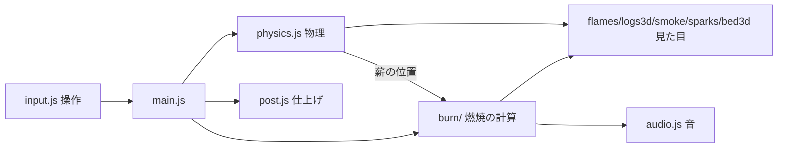

# architecture — どう作るか

最終更新: 2026-10-08

## 技術

- ビルドなし。`index.html` が import map で CDN から読む：three.js 0.180.0（WebGL2）・Rapier 3D 0.19.0（物理）
- 起動：`npx -y http-server . -p 5191 -c-1` → http://localhost:5191
- 音はプログラムで合成（Web Audio）。振動は Gamepad API
- 保存は localStorage（10秒ごと）。再開時は離れていた時間（最大3時間）を1秒刻みで一気に計算する
- 音は開始画面のボタンを押したときに作る（ブラウザの「操作するまで音を出さない」制限への対応）。マイクは V キーを押したときだけ許可を求める
- 画面の文字・ボタンの見た目は index.html の中の style にまとめている

## ファイルの役割

| 層 | ファイル | 役割 |
|---|---|---|
| 入口 | index.html / js/main.js | 開始画面・全部をつなぐ・毎コマの更新・光・保存と再開 |
| 燃焼（画面なし） | js/burn/types.js | 燃える物の定義と物の性質（単位は m・kg・秒・℃） |
| | js/burn/log.js | 薪をマス目に分けた状態・熱分解・はぜの元・折れる |
| | js/burn/fire.js | 炎の大きさ・酸素・熾火の床・放射・炉の寸法（TRAY・PIT） |
| 見た目 | js/scene.js | 地面・石囲炉・岩・木・素材の読み込み |
| | js/logs3d.js | 薪の見た目（焦げ → 炭 → 光るひび → 灰） |
| | js/flames.js / smoke.js / sparks.js / bed3d.js | 炎のパラパラ漫画・煙・火の粉・熾火の床 |
| | js/post.js | 陽炎・ブルーム・露出・周辺減光など |
| | js/tools3d.js | マッチ・火ばさみの見た目と大きさ |
| | js/piles.js | 材料の山 |
| 操作 | js/input.js | 持つ・置く・落とす・火ばさみ・見回す・吹く・マイク |
| | js/ui.js | 棚・≡ メニュー |
| 物理 | js/physics.js | Rapier。割り薪は扇形の凸包、痩せたら作り直す |
| 音・振動 | js/audio.js / haptics.js | 3層の合成音・ゲームパッドの振動 |
| 測る | js/bench.js | `?bench`：部品ごとの GPU の時間 |
| 道具 | tools/sim.mjs / sustain.mjs | 燃焼だけを画面なしで回して秒数を測る |
| | tools/footage-flames.mjs / bake-smoke.mjs / fetch-polyhaven.mjs / clean-assets.mjs | 素材づくり |

## データの流れ

- 燃焼の計算は画面なしでも動く（tools/sim.mjs から呼べる）。**見た目のコードを burn/ に入れない**

## 素材

- 炎：作者が撮った焚き火の動画から切り抜いたパラパラ漫画（assets/flames）。元の動画は入れない（.gitignore の footage/）
- 薪・地面・岩：Poly Haven（CC0）。出どころは CREDITS.md
- 正解集の写真：reference/（公開しない）

## 今後の構造の変更（決まっているもの）

- スマホ対応：操作をマウス専用からタッチにも対応させる（input.js）。重さの目標は本人のスマホで 60fps
- 時間帯：本人の時計で空と光を変える（scene.js・main.js）

## 測って確かめること（スマホ対応の前に）

2026-10-08 Gemini のレビューで出た懸念。推測では決めず、測ってから直すか決める。

- 再開時の一気の計算（最大10,800回）で、開くまで何秒止まるか
- 薪が痩せたときに当たり判定を作り直す回数と時間
- 燃焼の計算（マス目）が1コマで何ms使うか（重ければ Web Worker に分ける）
- 10秒ごとの保存で、その1コマが何ms遅れるか
- 公開版では CDN のライブラリを同梱するか（オフラインで動かすか）
